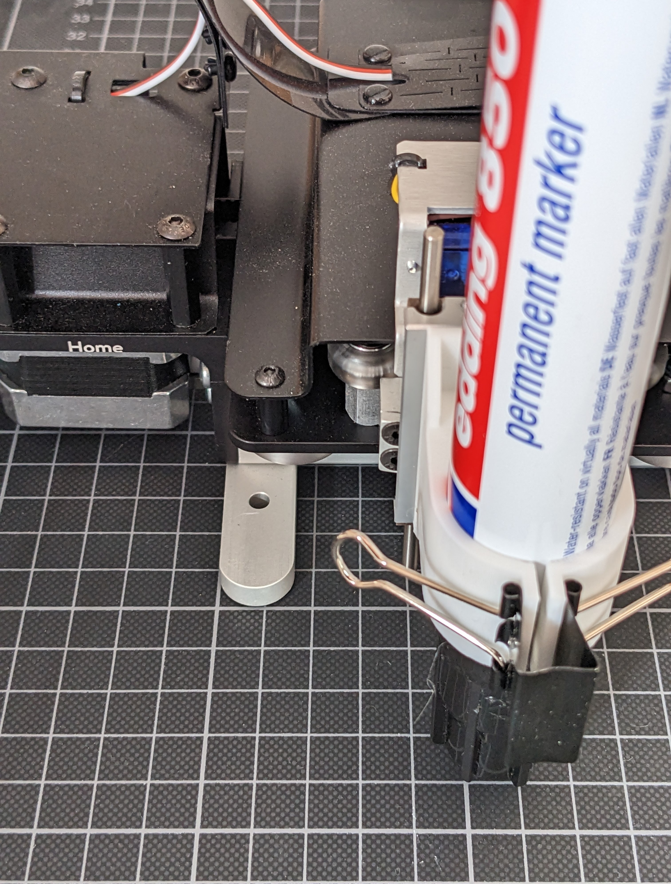
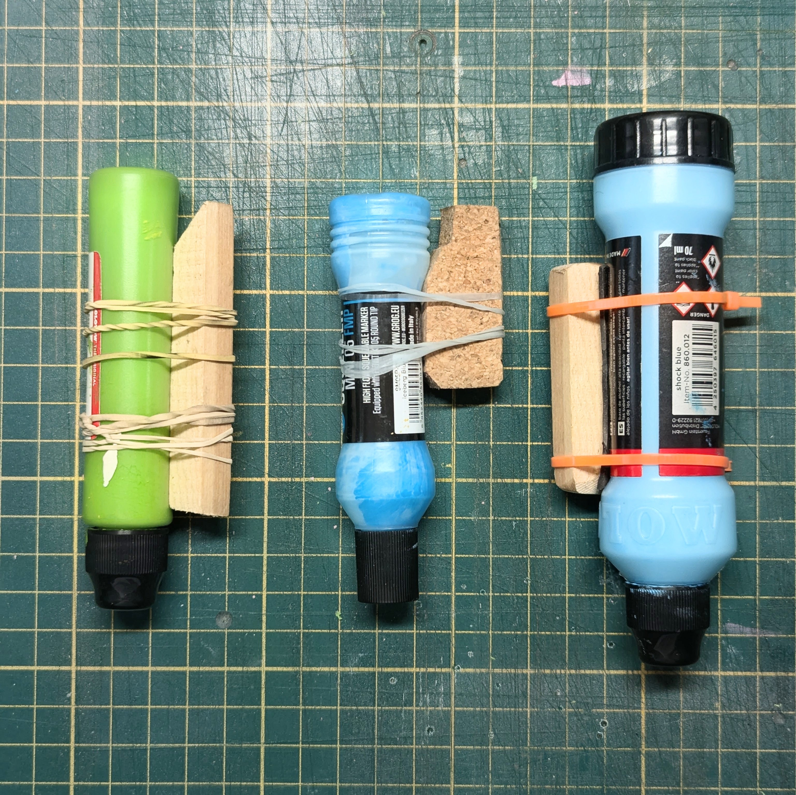
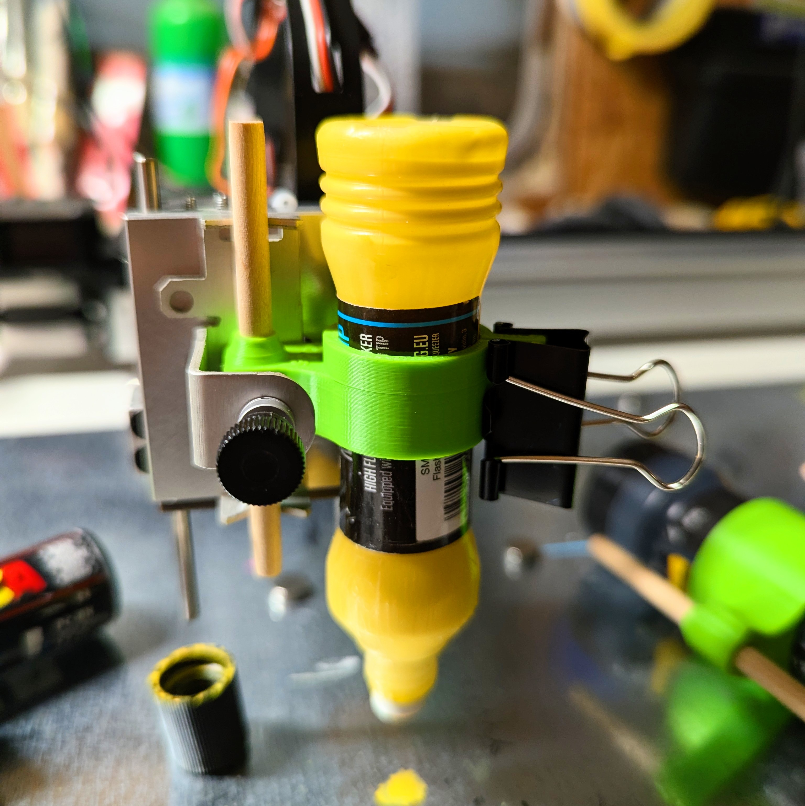
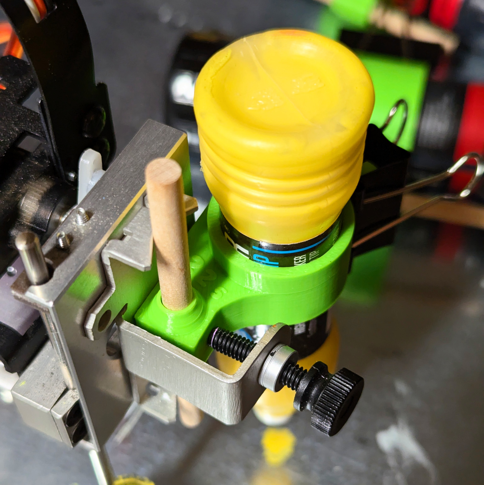
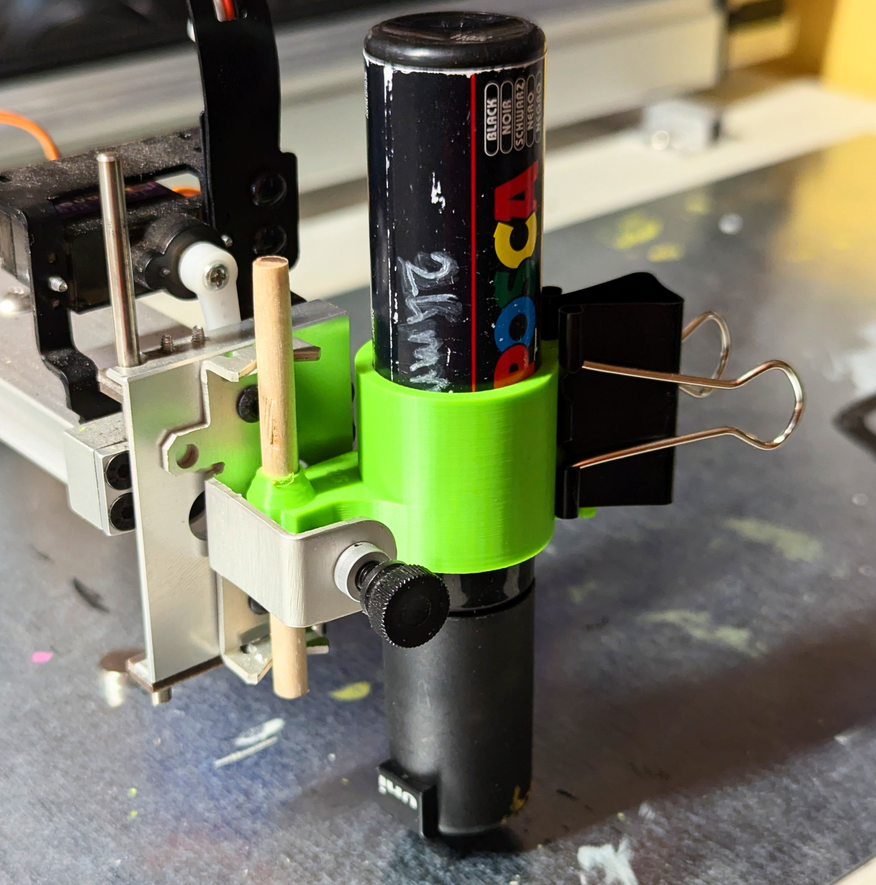
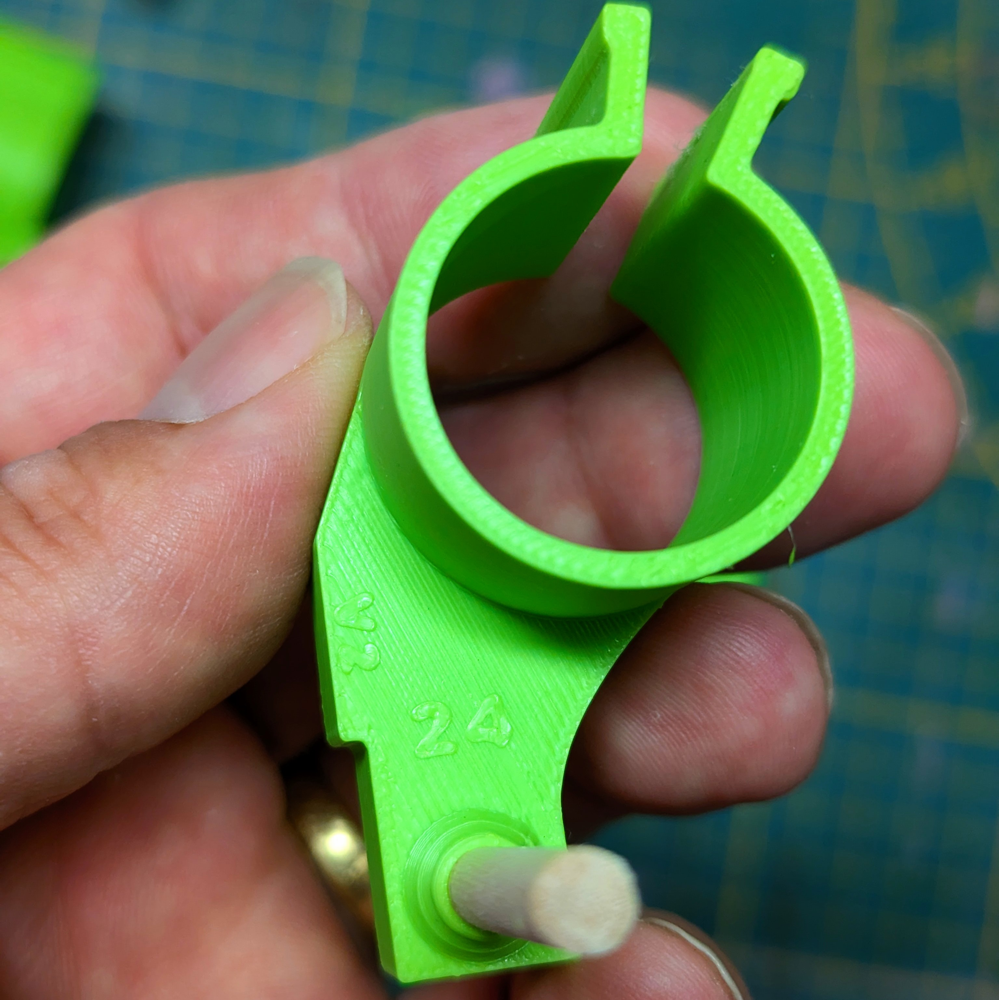
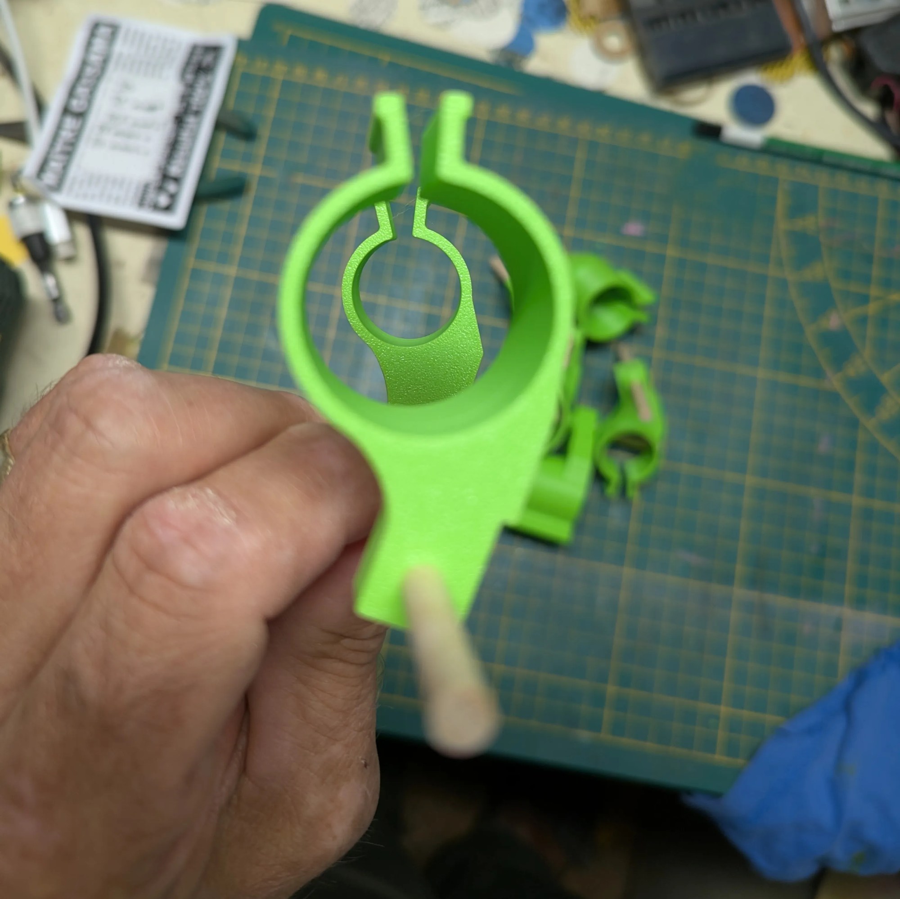
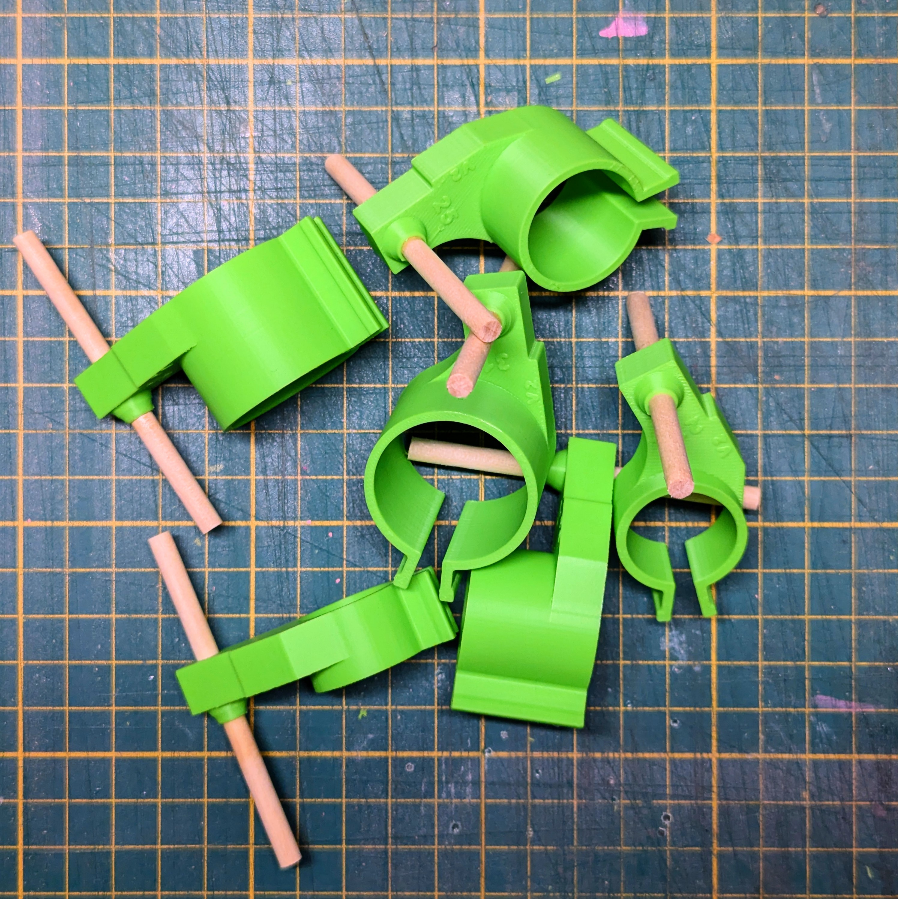
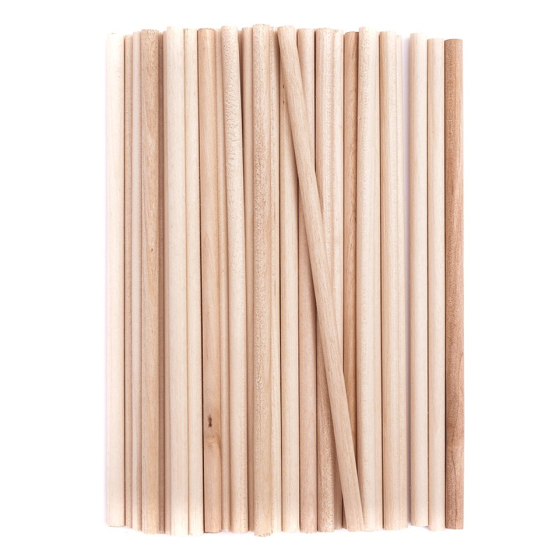

# Holder for axidraw

6 STL files for printing “holders” that fit into the base holder of EvilMadScience/BantamTools Axidraw penplotter.
Tested on Axidraw™ V3 (A4) and NextDraw™ 2234 (A1)

# Holder de gros feutres pour axidraw
## la version courte
6 fichiers STL pour imprimer des "holders" qui se placent dans le holder de base des axidraws de EvilMadScience/BantamTools.
Testé sur Axidraw™ V3 (A4) et NextDraw™ 2234 (A1)

## La version longue
Le défaut des axidraw est, entre autres, la pièce métallique qui permet de tenir le crayon. il est prévu pour des crayons dont le diamètre ne dépasse pas **16 mm**.
Ce diamètre correspond au PC-5M de Posca avec une pointe de 1.8 - 2.5 mm, au delà ce n’est pas possible sauf à acheter le bout d’alu plié avec un Velcro pour la modique somme de 21€ disponible aux US[^1]

)

Il faut dévisser le holder et revisser le nouveau (2 ptt vis avec une clé 6 pans) et le faire à chaque fois quand on revient à un crayon “normal”. Outre la manip laborieuse, dans le cadre d’une machine partagée, c’est l’enfer.

Ma recherche sur les sites de modèles imprimables n’a remonté qu’un holder (de emnullfuenf) affublé du même défaut de montage/démontage, par contre j’aimais beaucoup le système de pince à dessin pour maintenir le feutre en place. Qu’il en soit ici remercié.

par emnullfuenf - licensed under Creative Commons - Attribution

L’idée était de garder le holder standard et de venir se greffer dessus pour maintenir un crayon plus gros. Dans l’atelier, trainait un bout de cadre photo en pin qui s’avérait s’insérer correctement dans le holder et se bloquer dans les “griffes” en V (la fente pour coincer les crayons normaux). J’ai fixé le tout avec des élastiques et un bout de chambre à air pour donner de l’accroche au cylindre du feutre avec le bois…
Pas beau mais fonctionnel pour l’axidraw et pas pratique pour dessiner à la main avec l’augmentation.

Nous avons la chance au lycée de travailler régulièrement avec l’edulab Rennes 2 et de profiter de leurs initiations avec les étudiants. J’ai révisé leurs tutos et je me suis mis à Tinkercad™.

Une première version a vue le jour en quelques heures (après 11 itérations quand même) et différents diamètres de holder ont été nécessaires pour faire rentrer tous les modèles de feutres que j’avais à l’atelier (j’ai des achats un peu obsessionnels/compulsifs dès que je vois une boutique de matos de street-art)

Au final, il y a 6 modèles qui sont compatibles avec les feutres et marqueurs et autres drip de :

- **21 mm** :
    - Paint Markers Molotow™
- **22,5 mm** :
    - Squeezer mini 5, 35ml, Grog.eu™
    - Street Dabber 10mm Montana™
- **24 mm** :
    - Drip Stick small 6mm, 30ml, Molotow™
    - Drip Stick small 10mm, 30ml, Molotow™
    - Ripper de Dopecans
- **25 mm** :
    - Posca PC-8K
- **29 mm** :
    - Posca PC-17K
- **31 mm** :
    - Drip Stick 10 mm, 70ml, Molotow™

Suite à la remarque de @bntwmr, j’ai modifié le design pour que tous les centres des feutres soient à la même distance du bout de bois (le point de pivot normal).
**30mm** dans la grande dimension et **10mm** dans l’autre (ça dépend comment on pose le format sur l’axidraw)
Ça permet de changer de feutre et de holder, sans recaler le papier quand on fait plusieurs passes (il est malin Benoît).
Donc il y a une v2.
Le squeezer mini de Grog, m’a donné du fil à retordre aà cause de sa forme de sa hauteur, le holder est plus court.

Le petit bout de bois utilisé est un bâtonnet de 5mm de diamètre et 15 cm de long, vendu par [DALPRINT](https://www.dpcraft.pl/en/patyczki-kreatywne/1249-patyczki-kreatywne-okragle-naturalne-50-szt-5907590011377.html).

au prix de 2,2€ les 50 bâtonnets, ils ont un magasin en ligne (ouf) et c’est l’Europe.

[^1]: merci la douane, les frais de port fast&furious d’UPS et la tva sur les frais de ports… Ok la TVA sur la marchandise… Mais payer la tva Française sur un service acheté à l’étranger… grrrr?
